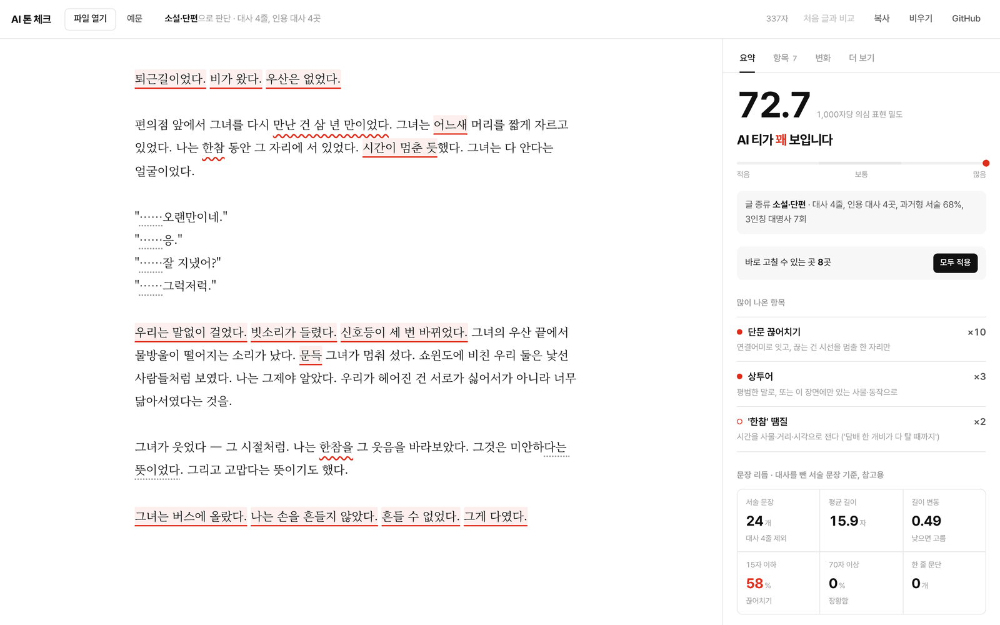
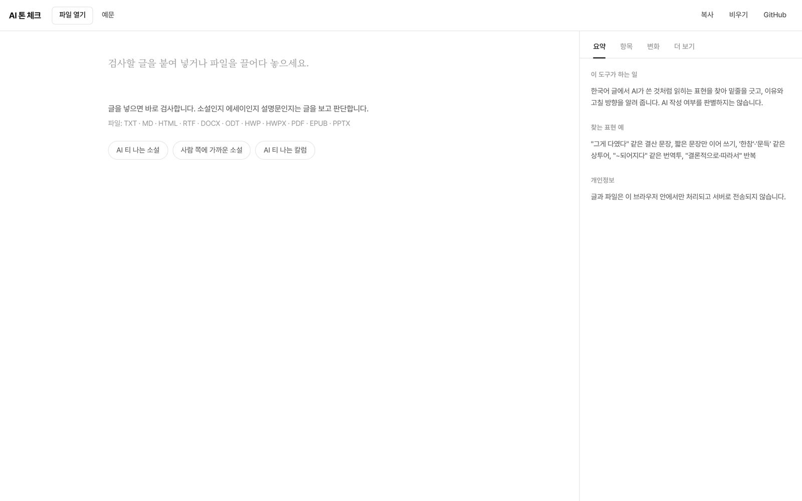
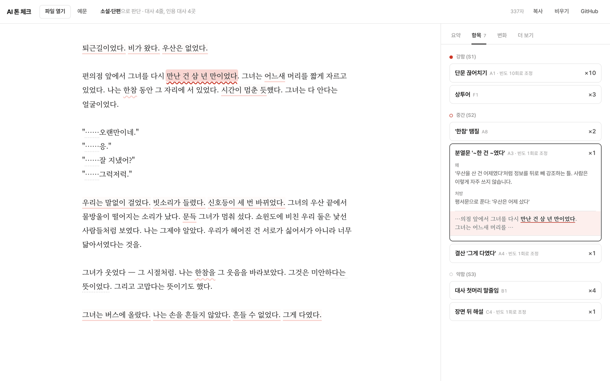
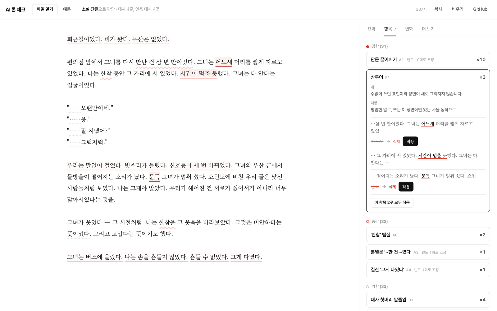
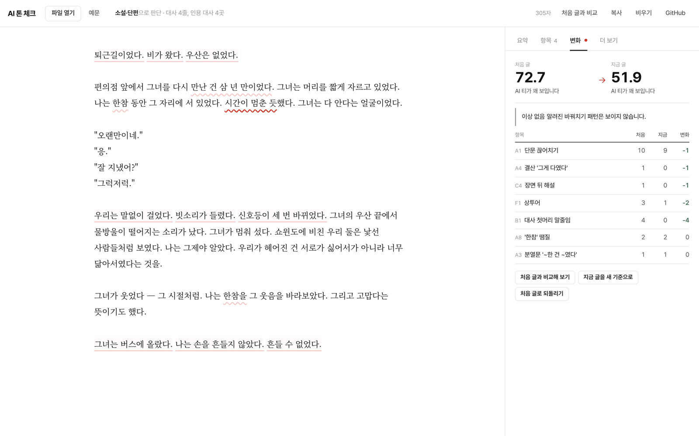
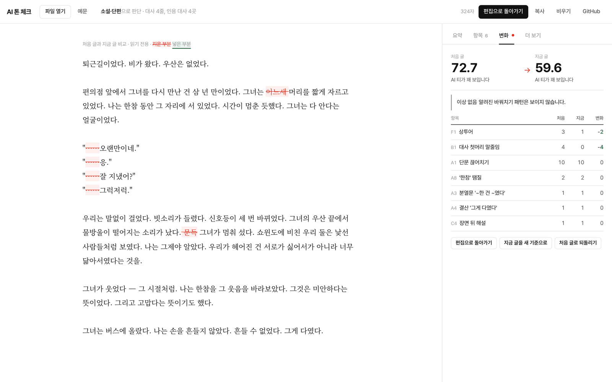
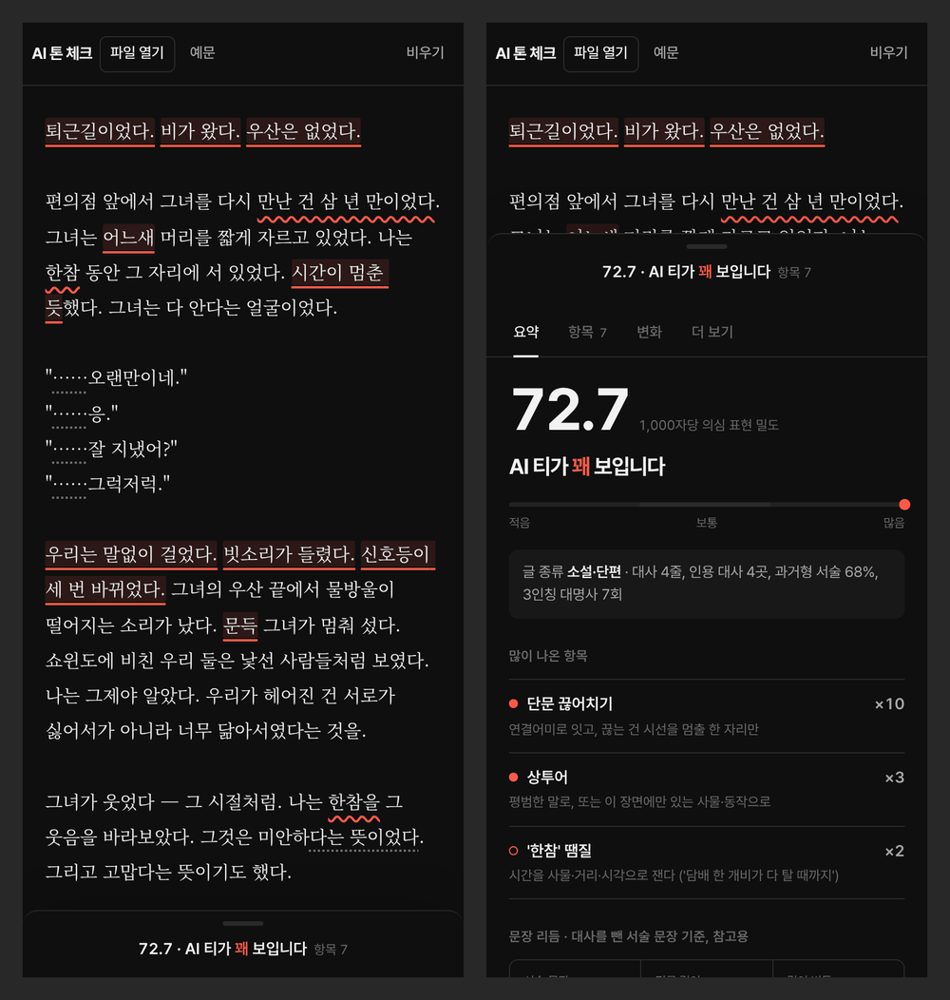

# AI 톤 체크

한국어 글에서 AI가 쓴 것 같은 부분에 밑줄을 긋고, 어떻게 고치면 좋을지 알려 주는 웹 도구입니다.

[](https://github.com/devvshyun/AIToneCheck/actions/workflows/pages.yml)

데모: https://devvshyun.github.io/AIToneCheck/ (따로 설치하거나 가입할 필요 없음)



## 무엇을 하나

글을 붙여 넣거나 파일로 올리면 AI 글에서 자주 보이는 표현에 밑줄을 긋습니다. 밑줄을 누르면 왜 걸렸는지, 어떻게 고치면 좋을지가 오른쪽에 나옵니다. 단어 하나를 빼거나 바꾸면 되는 곳은 고친 문장도 같이 보여 주고, `적용`을 누르면 편집기에 바로 반영됩니다. 마음에 안 들면 Ctrl+Z로 되돌리면 됩니다.

글을 고치면 그 자리에서 다시 검사합니다. 고치다 보면 다른 상투 표현이 그 자리에 들어오기 쉬운데, 처음 글과 비교해 이런 경우도 짚어 줍니다.

소설, 에세이, 시나리오, 설명문은 글 생김새를 보고 알아서 구분합니다. HWP, DOCX, PDF 같은 파일도 그대로 올리면 되고, 글과 파일은 브라우저 밖으로 나가지 않습니다.

## 사용 방법

### 1. 글 넣기

편집기에 글을 붙여 넣거나 파일을 끌어다 놓습니다. 상단 `파일 열기`나 `예문`으로도 시작할 수 있습니다. 글이 들어가면 바로 검사가 돌고, 상단에 어떤 종류의 글로 봤는지와 그 근거가 나옵니다.



### 2. 요약 보기

오른쪽 패널의 `요약` 탭입니다(맨 위 캡처). 큰 숫자는 글 1,000자에 의심 표현이 얼마나 몰려 있는지를 나타냅니다. 그 아래에 가장 많이 걸린 항목 3개, 문장 길이 같은 리듬 수치, 연결어미 분포가 나옵니다. 리듬 수치는 대사를 빼고 서술 문장만 셉니다.

### 3. 밑줄 눌러 보기

밑줄 모양으로 강도를 구분합니다. 실선은 강함, 물결은 중간, 점선은 약함입니다. 밑줄을 누르면 `항목` 탭에서 해당 항목이 펼쳐지고 같은 항목의 다른 위치는 진하게, 나머지는 흐리게 바뀝니다.



### 4. 고친 안 적용

바로 고칠 수 있는 곳에는 고치기 전과 후, `적용` 버튼이 붙습니다. 누르면 편집기 글이 바뀌고 곧바로 다시 검사합니다. 같은 항목을 한꺼번에 고치려면 `이 항목 모두 적용`을 누르고, 되돌릴 때는 Ctrl+Z(맥은 Cmd+Z)를 누릅니다. 버튼이 없는 항목은 처방을 보고 편집기에서 직접 고쳐야 합니다.



### 5. 변화 확인

글을 고치면 `변화` 탭에 빨간 점이 뜹니다. 처음 글과 지금 글을 놓고 항목마다 몇 번 줄고 늘었는지 보여 줍니다. 설명하는 문장을 지웠더니 '한참'이 늘었다든가 하는 식으로, 고치면서 다른 버릇이 생기면 따로 알려 줍니다. `지금 글을 새 기준으로`, `처음 글로 되돌리기` 버튼도 여기 있습니다.



상단 `처음 글과 비교`를 누르면 편집기 자리에 비교 화면이 뜹니다. 지운 부분은 빨간 취소선, 넣은 부분은 초록 밑줄로 표시됩니다.



### 6. 더 보기

규칙으로는 잡기 어려워서 직접 읽으며 확인해야 하는 항목 목록(경구, 앞에서 보여 준 단서를 다시 짚는 문장, 맥락 없는 관용구 등)과 LLM에 붙여 넣을 검수 프롬프트, 검사 기준이 있습니다.

### 모바일

휴대폰에서는 편집기가 화면을 채우고, 아래 막대를 누르면 결과가 올라옵니다. 기기가 다크 모드면 페이지도 어둡게 바뀝니다.



## 찾는 표현

정해 둔 패턴(정규식)에 맞는 표현을 후보로 뽑습니다. 문맥상 괜찮은 표현도 걸릴 수 있으니 고칠지는 읽어 보고 정하면 됩니다.

| 분류 | 예 | 출처 |
| --- | --- | --- |
| 끊고 정리하는 습관 | 짧은 문장만 이어 쓰기, "우산을 산 건 어제였다", "그게 다였다", "그제야 알았다", "~는 얼굴이었다", '한참' | 작품 검수 기준 ([docs/ai-tone-essence.md](docs/ai-tone-essence.md)) |
| 기호·나열 | 대사 첫머리 "……" 반복, 줄표(—), 세 가지씩 나열 | 〃 |
| 다시 설명하기 | "~할 것 같아서였다", "틀린 말은 아니었다", "~라는 뜻이었다" | 〃 |
| 꾸밈·상투어 | "어느새", "문득", "시간이 멈춘 듯", "손이 먼저 대답했다", 감정 단어 직접 쓰기 | 〃, 1day1writing 소설 생성 금지 목록 |
| 리듬 | 문장 길이가 고름, 70자 넘는 문장, 같은 연결어미('-는데', '-었고') 쏠림 | 〃 |
| 번역투 | "~되어지다", "~에 있어서", "~에 의해", 연결어미 뒤 쉼표 | [im-not-ai](https://github.com/epoko77-ai/im-not-ai), [stop-slop-ko](https://github.com/leeandev/stop-slop-ko) |
| 설명문 관용구 | "결론적으로·따라서" 반복, "시사하는 바가 크다", "~할 때입니다", "오늘은 ~에 대해 알아보겠습니다" | 〃 |
| 대사 | 직함만 부르는 호칭("알았다니까, 실장!"), "목으로 하지 마. 배로 해." 같은 맞세운 명령, "밥 드시는 분" | 시나리오 검수 피드백 |

연결어미 뒤 쉼표는 KatFish 연구(ACL 2025)에서 사람 글 4.1%, AI 글 19.8%로 차이가 가장 컸던 지표입니다. 규칙과 처방 전체는 [js/rules.js](js/rules.js)에 있습니다.

### 등급과 판정

- 한 번 나온 표현은 대개 문제없어서 한 단계 낮춰 표시합니다. 여러 번 나오거나 한곳에 몰려 있을 때 무겁게 봅니다.
- 같은 표현이 10번 넘게 나오면 가장 강한 등급으로 올립니다.
- 판정은 "AI 티가 꽤 보입니다 / 부분적으로 보입니다 / 거의 사람 글입니다" 세 가지입니다. 한 분류에서만 걸렸다면 글쓴이 문체일 수도 있어서 가장 높은 판정은 주지 않습니다.

### 장르 자동 판단

| 판단 | 근거 |
| --- | --- |
| 소설 | 따옴표로 시작하는 대사 줄, 과거형 서술(~었다), 3인칭 대명사(그는, 그녀는) |
| 에세이 | 1인칭(나는, 우리는), 회상 어휘(기억, 요즘, 어릴 적), 대사 없는 '~다' 서술 |
| 설명문 | '~습니다/~요' 종결, 제목·목록 줄, 숫자, 설명문 어휘(분석, 따라서 등) |
| 시나리오·대본 | 씬 머리(`S#1.`, `INT.` 등), `이름[탭]대사`·`이름: 대사` 줄 |

소설인지 에세이인지 애매하면 "소설 또는 에세이"로 표시합니다. 둘은 적용하는 규칙이 거의 같습니다. 시나리오는 대사 줄을 대사로 따로 빼고, 지문은 원래 짧게 끊어 쓰기 때문에 짧은 문장 관련 규칙을 느슨하게 적용합니다.

## 지원 파일

| 형식 | 읽는 방법 |
| --- | --- |
| TXT, CSV, JSON, SRT, VTT, LOG | 인코딩 자동 판별 (UTF-8, UTF-16, EUC-KR) |
| MD | 제목·목록·강조·링크·코드 블록 기호를 빼고 본문만 |
| HTML, XHTML, XML | 스크립트·스타일·메뉴를 빼고 본문만 |
| RTF | 한국어 코드페이지(949)와 유니코드 모두 해석 |
| DOCX, DOCM, DOTX | 본문, 각주, 미주 |
| ODT, ODP | 본문 |
| HWPX | 구역(section) 순서대로 본문 |
| HWP (한글 5.0 이후) | 본문 문단 텍스트만 추출 |
| PDF | 텍스트가 들어 있는 PDF |
| EPUB | 목차 순서대로 장 본문 |
| PPTX | 슬라이드 순서대로 텍스트 상자 |

읽을 수 없는 파일은 이유와 함께 안내합니다.

- 스캔한 이미지 PDF: 글자 인식(OCR)이 필요합니다.
- 배포용·암호가 걸린 한글 문서: 일반 문서로 저장해 올려 주세요.
- 구형 `.doc`, `.ppt`: `.docx`, `.pptx`로 저장해 올려 주세요.
- 20만 자가 넘는 글은 앞부분만 검사합니다.

## 한계

- AI가 썼는지 사람이 썼는지 가려내는 도구가 아닙니다. 사람이 쓴 글에도 같은 표현은 나옵니다.
- 패턴만 보고 문맥은 읽지 못합니다. 그래서 대사의 말맛은 거의 못 봅니다. "사십 분이면 한 판이지, 뭐"처럼 앞뒤에 근거가 없는 관용구나 그 인물이 실제로는 안 쓸 말은 장면을 읽어야 알 수 있습니다. 이런 부분은 `더 보기` 탭의 프롬프트를 복사해 LLM에 맡기는 편이 낫습니다.
- README처럼 이 도구로 검사해 통과한 글도 번역투가 남아 있을 수 있습니다. 걸리지 않았다고 자연스러운 글이라는 뜻은 아닙니다.
- PDF는 줄 끝 공백 정보가 없어서 띄어쓰기 자리에서 바뀐 줄이 붙어 나올 수 있습니다(예: "입니다그러면").
- 페이지가 직접 LLM을 부르지는 않습니다. 프롬프트에는 지금 글, 검사 결과, 검사 기준이 들어 있어서 Claude 같은 챗봇에 그대로 붙여 넣으면 됩니다.

## 개발

빌드 없이 돌아가는 정적 페이지입니다. ES 모듈을 써서 `index.html`을 파일로 바로 열면 동작하지 않으니 정적 서버로 엽니다.

```bash
python3 -m http.server 5173   # http://localhost:5173
npm test                      # 단위 테스트 (Node 20 이상)
```

### 구조

```
index.html              화면
css/style.css           스타일 (라이트·다크)
js/
  app.js                작업 화면: 편집기 밑줄, 결과 패널, 고친 안 적용, 비교
  analyzer.js           대사 분리, 리듬 지표, 규칙 실행, 등급 조정, 판정, 다시 검사 비교
  rules.js              규칙 목록: 정규식, 등급, 이유, 처방, 고친 안 생성
  detect.js             장르 자동 판단
  extract.js            파일에서 텍스트 추출 (형식별 파서)
  diff.js               처음 글과 지금 글 비교 (단어 단위 Myers diff)
  prompt.js             LLM 검수 프롬프트 생성
  samples.js            데모 예문
docs/
  ai-tone-essence.md    판정 기준 문서
  screenshots/          README 캡처
fonts/pretendard/       Pretendard 가변 서체 (동적 서브셋)
vendor/                 fflate, cfb, pdf.js
tests/                  node:test 단위 테스트
```

`analyzer.js`, `rules.js`, `detect.js`는 DOM을 쓰지 않아 Node에서도 그대로 돌아갑니다.

### 규칙 추가하기

`js/rules.js`의 `RULES` 배열에 항목을 넣습니다.

```js
{ id: "A8", group: "A", sev: 2, min: 2, genres: STORY,
  re: /한참(을|이나|동안)?/g,
  name: "'한참' 땜질",
  why: "해설을 지운 자리를 '한참 봤다'로 메우는 습관.",
  fix: "시간을 사물·거리·시각으로 잰다" },
```

| 필드 | 뜻 |
| --- | --- |
| `sev` | 기본 등급. 1 강함, 2 중간, 3 약함 |
| `min` | 글 전체에서 이 횟수 이상일 때만 표시 |
| `genres` | 적용 장르. 생략하면 전체 |
| `scope` | `narration`(기본, 대사 제외), `dialogue`, `all` |
| `suggest` | 고친 안 생성 함수. 바꿀 문자열을 돌려주거나, 문장을 지우도록 `DELETE_SENTENCE`를 돌려줌 |

정규식 lookbehind(`(?<=`, `(?<!`)는 쓰지 않습니다. Safari 16.4 미만은 이 문법을 몰라서 페이지 전체가 멈춥니다. 앞 글자를 조건으로 걸어야 하면 `(?<pre>^|[^가-힣])`처럼 이름 붙은 그룹으로 잡으세요. 분석기가 그 길이만큼 밑줄 위치를 맞춥니다. lookbehind가 들어가면 테스트가 실패합니다.

### 배포

`main`이나 작업 브랜치에 푸시하면 `.github/workflows/pages.yml`이 테스트를 돌리고 GitHub Pages에 올립니다. 처음 한 번은 저장소 Settings → Pages → Source를 **GitHub Actions**로 바꿔 둬야 합니다.

### 캡처 다시 찍기

README 캡처는 데모 예문 "AI 티 나는 소설"을 `.docx`로 만들어 올린 화면입니다. 가로 1440px, 2배율로 찍어 1600px로 줄였습니다. 화면이 바뀌면 같은 순서로 다시 찍어 `docs/screenshots/`를 바꿉니다.

## 참고 자료와 라이선스

- 판정 기준: 작품 검수용 `ai-tone/기준.md`, `ai_tone_scan.py`에서 뽑은 [docs/ai-tone-essence.md](docs/ai-tone-essence.md)
- 번역투·설명문 규칙: [epoko77-ai/im-not-ai](https://github.com/epoko77-ai/im-not-ai) (MIT), [leeandev/stop-slop-ko](https://github.com/leeandev/stop-slop-ko) (MIT)
- 쉼표 통계: Park et al., *Detecting LLM-Generated Korean Text through Linguistic Feature Analysis* (KatFish, ACL 2025)

| 포함한 라이브러리·서체 | 라이선스 |
| --- | --- |
| [Pretendard](https://github.com/orioncactus/pretendard) | SIL OFL 1.1 |
| [Noto Serif KR](https://fonts.google.com/noto/specimen/Noto+Serif+KR) (Google Fonts에서 로드) | SIL OFL 1.1 |
| [pdf.js](https://github.com/mozilla/pdf.js) 4.10.38 | Apache-2.0 |
| [fflate](https://github.com/101arrowz/fflate) 0.8.2 | MIT |
| [cfb](https://github.com/SheetJS/js-cfb) 1.2.2 | Apache-2.0 |
