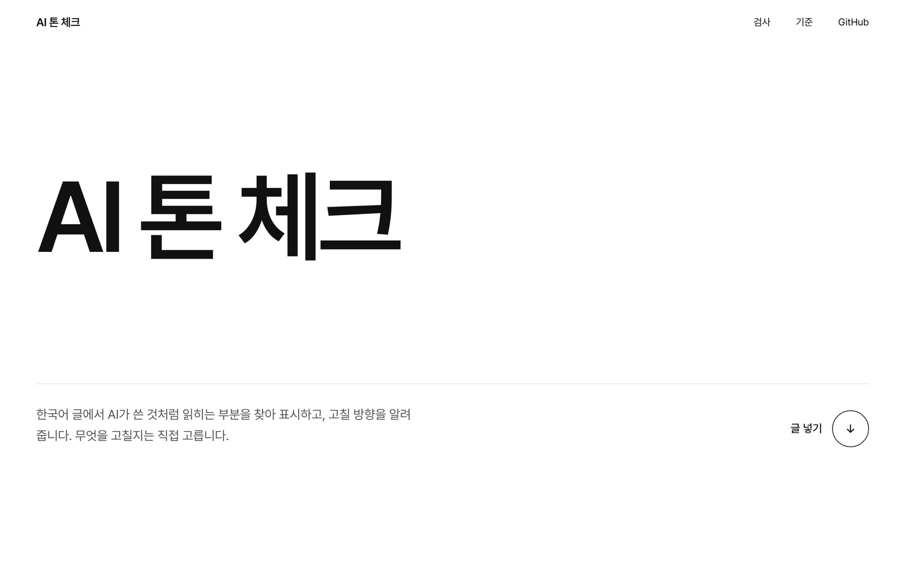
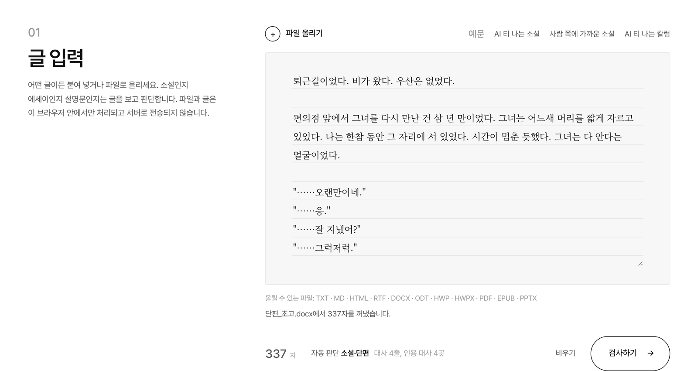
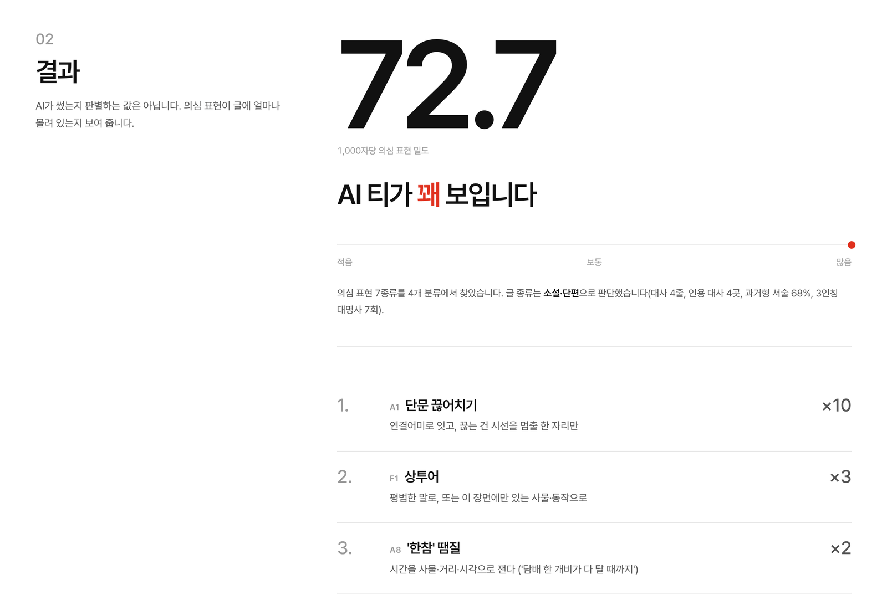
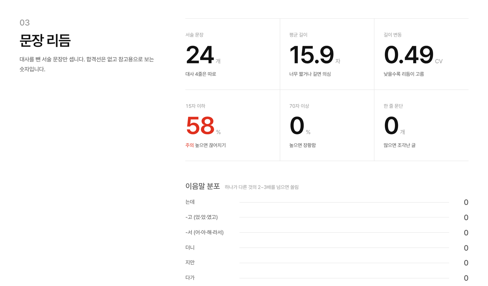
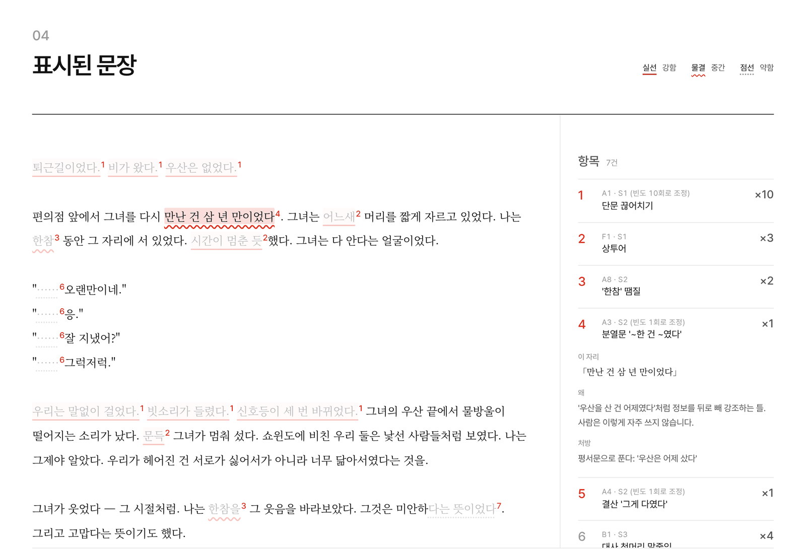
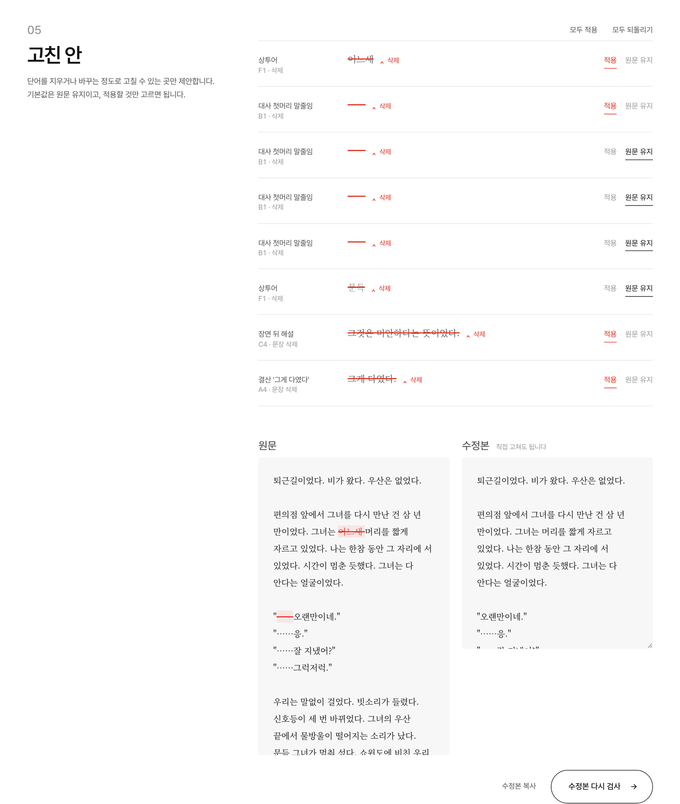
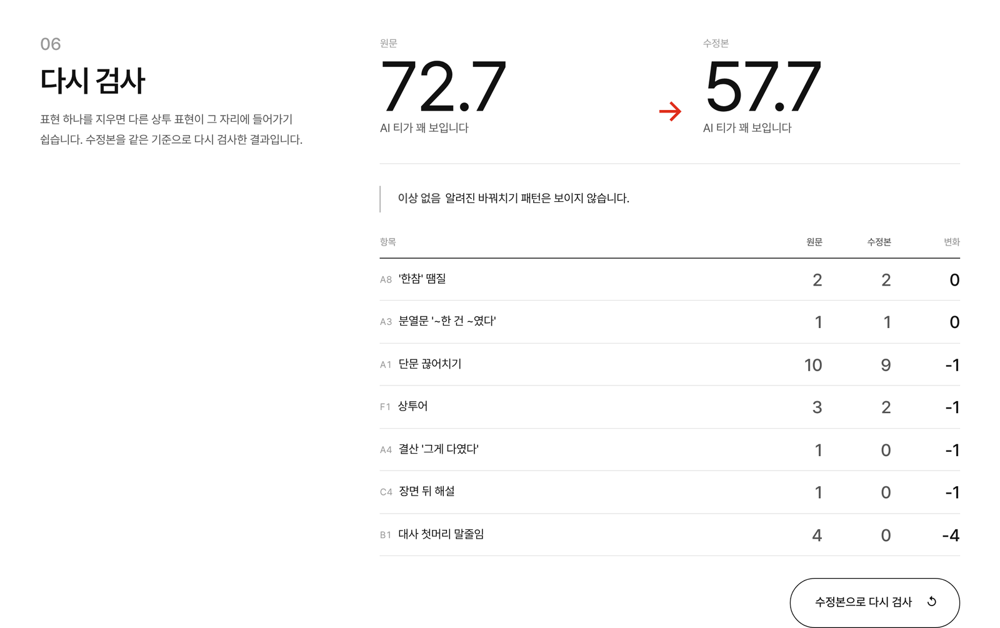

# AI 톤 체크

한국어 글에서 AI가 쓴 것처럼 읽히는 부분을 찾아 표시하고 고칠 방향을 알려 주는 웹 도구입니다.

[](https://github.com/devvshyun/AIToneCheck/actions/workflows/pages.yml)

**[데모 열기 →](https://devvshyun.github.io/AIToneCheck/)** 설치나 로그인 없이 브라우저에서 바로 씁니다.



## 주요 기능

- **문장 단위 표시**: 의심 표현에 밑줄을 긋고 누르면 이유와 처방을 보여 줍니다.
- **고친 안 제안**: 단어를 지우거나 바꾸는 정도로 고칠 수 있는 곳은 수정 전후를 나란히 보여 줍니다. 적용 여부는 직접 고릅니다.
- **다시 검사**: 고친 글을 같은 기준으로 다시 돌려, 고치는 과정에서 새로 생긴 상투 표현까지 짚습니다.
- **장르 자동 판단**: 소설, 에세이, 설명문을 글의 겉모양으로 판단해 그에 맞는 규칙을 적용합니다.
- **파일 업로드**: HWP, HWPX, DOCX, PDF, TXT, MD 등 11가지 형식을 끌어다 놓으면 바로 검사합니다.
- **서버 전송 없음**: 글과 파일은 모두 브라우저 안에서 처리됩니다. API 키도 필요 없습니다.

## 사용 방법

### 1. 글 넣기

글을 붙여 넣거나 파일을 끌어다 놓습니다. 글을 넣는 동안 입력창 아래에 장르 판단 결과와 근거가 나옵니다.



### 2. 결과 확인

큰 숫자는 1,000자당 의심 표현 밀도입니다. AI가 썼는지 판별하는 값은 아니고 의심 표현이 얼마나 몰려 있는지 보여 줍니다. 아래에는 가장 많이 나온 항목 3개와 줄이는 방향이 나옵니다.



문장 리듬은 대사를 뺀 서술 문장만 셉니다. 기준선을 넘었는지 보는 숫자는 없고 눈에 띄는 값만 빨간색으로 표시합니다.



### 3. 표시된 문장 읽기

밑줄 모양으로 강도를 구분합니다. 실선은 강함, 물결은 중간, 점선은 약함입니다. 밑줄이나 오른쪽 항목을 누르면 그 자리의 이유와 처방이 펼쳐집니다.



### 4. 고친 안 고르고 다시 검사

제안마다 `적용` 또는 `원문 유지`를 고릅니다. 기본값은 원문 유지입니다. 수정본 칸에서 직접 더 고친 뒤 `수정본 다시 검사`를 누릅니다.



다시 검사하면 항목별로 원문과 수정본의 횟수를 비교합니다. 설명 문장을 지운 자리에 '한참'이 늘어나는 식의 바꿔치기가 보이면 따로 경고합니다.



### 모바일

같은 기능이 휴대폰에서도 동작하고 시스템 설정에 따라 다크 모드로 바뀝니다.


## 찾는 표현

규칙은 정규식으로 후보를 뽑는 방식입니다. 문맥상 문제없는 표현도 걸릴 수 있어서 고칠지는 읽고 판단해야 합니다.

| 분류 | 예 | 출처 |
| --- | --- | --- |
| 끊고 정리하는 습관 | 짧은 문장만 이어 쓰기, "우산을 산 건 어제였다", "그게 다였다", "그제야 알았다", "~는 얼굴이었다", '한참' | 작품 검수 기준 ([docs/ai-tone-essence.md](docs/ai-tone-essence.md)) |
| 기호·나열 | 대사 첫머리 "……" 반복, 줄표(—), 세 가지씩 나열 | 〃 |
| 다시 설명하기 | "~할 것 같아서였다", "틀린 말은 아니었다", "~라는 뜻이었다" | 〃 |
| 꾸밈·상투어 | "어느새", "문득", "시간이 멈춘 듯", "손이 먼저 대답했다", 감정 단어 직접 쓰기 | 〃, 1day1writing 소설 생성 금지 목록 |
| 리듬 | 문장 길이가 고름, 70자 넘는 문장, 같은 연결어미('-는데', '-었고') 쏠림 | 〃 |
| 번역투 | "~되어지다", "~에 있어서", "~에 의해", 연결어미 뒤 쉼표 | [im-not-ai](https://github.com/epoko77-ai/im-not-ai), [stop-slop-ko](https://github.com/leeandev/stop-slop-ko) |
| 설명문 관용구 | "결론적으로·따라서" 반복, "시사하는 바가 크다", "~할 때입니다", "오늘은 ~에 대해 알아보겠습니다" | 〃 |

연결어미 뒤 쉼표는 KatFish 연구(ACL 2025)에서 사람 글 4.1%, AI 글 19.8%로 차이가 가장 크게 난 지표입니다. 전체 규칙과 처방은 [js/rules.js](js/rules.js)에 있습니다.

### 등급과 판정

- 같은 표현이 한 번만 나오면 한 단계 낮춰 표시합니다. 반복되거나 몰려 있을 때만 무겁게 봅니다.
- 같은 표현이 10번 이상 나오면 가장 강한 등급으로 올립니다.
- 판정 문구는 "AI 티가 꽤 보입니다 / 부분적으로 보입니다 / 거의 사람 글입니다" 세 단계입니다. 한 분류에서만 신호가 나오면 개인 문체일 수 있어 가장 높은 단계로 올리지 않습니다.

### 장르 자동 판단

| 판단 | 근거 |
| --- | --- |
| 소설 | 따옴표로 시작하는 대사 줄, 과거형 서술(~었다), 3인칭 대명사(그는, 그녀는) |
| 에세이 | 1인칭(나는, 우리는), 회상 어휘(기억, 요즘, 어릴 적), 대사 없는 '~다' 서술 |
| 설명문 | '~습니다/~요' 종결, 제목·목록 줄, 숫자, 설명문 어휘(분석, 따라서 등) |

소설과 에세이의 근거가 비슷하면 "소설 또는 에세이"로 표시합니다. 두 장르는 적용 규칙이 거의 같습니다.

## 지원 파일

| 형식 | 읽는 방법 |
| --- | --- |
| TXT, CSV, JSON, SRT, VTT, LOG | 인코딩 자동 판별 (UTF-8, UTF-16, EUC-KR) |
| MD | 제목·목록·강조·링크·코드 블록 기호를 빼고 본문만 |
| HTML, XHTML, XML | 스크립트·스타일·메뉴를 빼고 본문만 |
| RTF | 한국어 코드페이지(949)와 유니코드 모두 해석 |
| DOCX, DOCM, DOTX | 본문, 각주, 미주 |
| ODT, ODP | 본문 |
| HWPX | 구역(section) 순서대로 본문 |
| HWP (한글 5.0 이후) | 본문 문단 텍스트만 추출 |
| PDF | 텍스트가 들어 있는 PDF |
| EPUB | 목차 순서대로 장 본문 |
| PPTX | 슬라이드 순서대로 텍스트 상자 |

읽을 수 없는 파일은 이유와 함께 안내합니다.

- 스캔한 이미지 PDF: 글자 인식(OCR)이 필요합니다.
- 배포용·암호가 걸린 한글 문서: 일반 문서로 저장해 올려 주세요.
- 구형 `.doc`, `.ppt`: `.docx`, `.pptx`로 저장해 올려 주세요.
- 20만 자가 넘는 글은 앞부분만 검사합니다.

## 한계

- 이 도구는 AI 작성 여부를 판별하지 않습니다. 사람이 쓴 글에서도 같은 표현은 나옵니다.
- 정규식 후보라서 문맥을 읽지 못합니다. 경구, 이미 보여 준 단서를 다시 짚는 문장, 정보 없는 꾸밈은 자동으로 잡기 어려워 결과 화면의 "직접 확인할 것" 목록으로 안내합니다.
- PDF는 줄 끝 공백 정보가 없어서 띄어쓰기 자리에서 바뀐 줄이 붙어 나올 수 있습니다(예: "입니다그러면").
- LLM을 호출하지 않습니다. 더 자세한 피드백이 필요하면 결과 화면의 "프롬프트 복사"로 검사 결과와 기준을 담은 프롬프트를 챗봇에 붙여 넣으면 됩니다.

## 개발

빌드 단계가 없는 정적 페이지입니다. ES 모듈을 쓰므로 `index.html`을 파일로 바로 열지 말고 정적 서버로 엽니다.

```bash
python3 -m http.server 5173   # http://localhost:5173
npm test                      # 단위 테스트 (Node 20 이상)
```

### 구조

```
index.html              화면
css/style.css           스타일 (라이트·다크)
js/
  app.js                화면 렌더링과 상호작용
  analyzer.js           대사 분리, 리듬 지표, 규칙 실행, 등급 조정, 판정, 다시 검사 비교
  rules.js              규칙 목록: 정규식, 등급, 이유, 처방, 고친 안 생성
  detect.js             장르 자동 판단
  extract.js            파일에서 텍스트 추출 (형식별 파서)
  prompt.js             LLM 검수 프롬프트 생성
  samples.js            데모 예문
docs/
  ai-tone-essence.md    판정 기준 문서
  screenshots/          README 캡처
fonts/pretendard/       Pretendard 가변 서체 (동적 서브셋)
vendor/                 fflate, cfb, pdf.js
tests/                  node:test 단위 테스트
```

`analyzer.js`, `rules.js`, `detect.js`는 DOM을 쓰지 않아서 Node에서도 그대로 돌아갑니다.

### 규칙 추가하기

`js/rules.js`의 `RULES` 배열에 항목을 넣습니다.

```js
{ id: "A8", group: "A", sev: 2, min: 2, genres: STORY,
  re: /한참(을|이나|동안)?/g,
  name: "'한참' 땜질",
  why: "해설을 지운 자리를 '한참 봤다'로 메우는 습관.",
  fix: "시간을 사물·거리·시각으로 잰다" },
```

| 필드 | 뜻 |
| --- | --- |
| `sev` | 기본 등급. 1 강함, 2 중간, 3 약함 |
| `min` | 글 전체에서 이 횟수 이상일 때만 표시 |
| `genres` | 적용 장르. 생략하면 전체 |
| `scope` | `narration`(기본, 대사 제외), `dialogue`, `all` |
| `suggest` | 고친 안 생성 함수. 바꿀 문자열을 돌려주거나, 문장을 지우도록 `DELETE_SENTENCE`를 돌려줌 |

구형 Safari(16.4 미만)도 지원하기 위해 정규식 lookbehind(`(?<=`, `(?<!`)는 쓰지 않습니다. 앞 글자 조건이 필요하면 `(?<pre>^|[^가-힣])`처럼 이름 붙은 그룹으로 잡으면 분석기가 하이라이트 위치를 맞춰 줍니다. 테스트가 lookbehind를 검사합니다.

### 배포

`main`이나 작업 브랜치에 푸시하면 `.github/workflows/pages.yml`이 테스트를 돌린 뒤 GitHub Pages로 배포합니다. 처음 한 번은 저장소 Settings → Pages → Source를 **GitHub Actions**로 바꿔야 합니다.

### 캡처 다시 찍기

README 캡처는 데모 예문 "AI 티 나는 소설"을 `.docx`로 올려 찍었습니다. 화면을 바꾸면 같은 흐름으로 `docs/screenshots/`를 갱신합니다(가로 1280px, 2배율로 찍고 1600px로 줄여 저장).

## 참고 자료와 라이선스

- 판정 기준: 작품 검수용 `ai-tone/기준.md`, `ai_tone_scan.py`에서 뽑은 [docs/ai-tone-essence.md](docs/ai-tone-essence.md)
- 번역투·설명문 규칙: [epoko77-ai/im-not-ai](https://github.com/epoko77-ai/im-not-ai) (MIT), [leeandev/stop-slop-ko](https://github.com/leeandev/stop-slop-ko) (MIT)
- 쉼표 통계: Park et al., *Detecting LLM-Generated Korean Text through Linguistic Feature Analysis* (KatFish, ACL 2025)

| 포함한 라이브러리·서체 | 라이선스 |
| --- | --- |
| [Pretendard](https://github.com/orioncactus/pretendard) | SIL OFL 1.1 |
| [Noto Serif KR](https://fonts.google.com/noto/specimen/Noto+Serif+KR) (Google Fonts에서 로드) | SIL OFL 1.1 |
| [pdf.js](https://github.com/mozilla/pdf.js) 4.10.38 | Apache-2.0 |
| [fflate](https://github.com/101arrowz/fflate) 0.8.2 | MIT |
| [cfb](https://github.com/SheetJS/js-cfb) 1.2.2 | Apache-2.0 |
